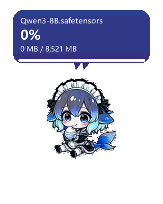
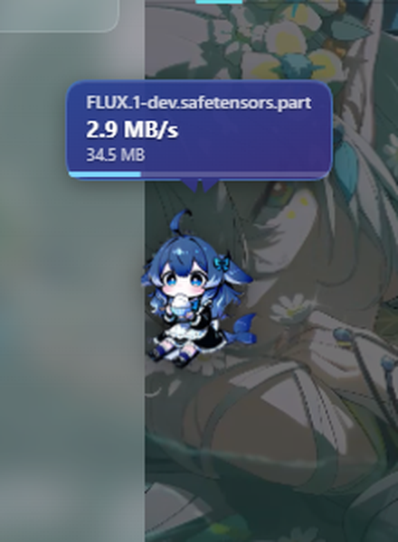

# 🐋 欧鲸鲸进度条

<p align="center">
  
   
  
  
</p>

<p align="center">
  
</p>

> **Agent 在后台闷头下一个 2 GB 的模型，你只能盯着聊天框干等。**
>
> 这个插件让一只鲸娘住进 DSH —— 磁盘上有东西在变大，她就抱着碗吃，
> 顺便报出文件名、速度、百分比、还剩多久。
>
> 不解析命令行，不认下载器：curl、aria2、浏览器、你自己写的脚本，谁的下载都看得见。

**装**（一条命令）：

```
plugin_manager action=install_bundle target="github:Kaius0629/dsh-oujingjing-progress"
```

装完打开「设置 → 鲸鲸进度条」，点「选择文件夹…」把你的下载目录加进去，完事。

一个 [DeepSeek Harness](https://github.com/deepseek-ai) 的 bundle 插件。零依赖、零构建、不改宿主代码。

## 🌊 为什么不是「又一个桌宠」

DSH 里已经有二十多个桌宠，鲸娘女仆尤其多。

它们的共同点是 —— 显示余额、token 消耗、任务状态、摸头喂食。

**没有一个会告诉你下载进度。**

这个插件只干一件事：把「磁盘上有个文件在变大」变成你一眼能看懂的东西。
不监工、不统计、不催你干活，下完了她就安静站着打盹。

## 🐋 四张脸


| 状态 | 什么时候 | 她什么样 |
|---|---|---|
| `eating` | 正在下载 | 抱着碗扒饭，气泡是蓝的 |
| `stuck` | 1.6 秒没长进 | 皱眉看空碗底，鳍耳耷下来，气泡变橙 |
| `done` | 下载结束 | 闭眼笑，气泡变绿，2.5 秒后退场 |
| `idle` | 没有下载 | 正对着你，端着一只空碗等饭 |

## 🔍 它凭什么知道你在下载

不解析命令行，不改下载方式，不要求你换下载器。

判据只有一条：**这个文件最近有没有被写过**（`mtime`）。

| 谁在下载 | 看得见吗 |
|---|---|
| `curl -o` / `wget -O` | ✅ |
| `python dl.py` 里自己写 `urllib` / `requests` | ✅ |
| `aria2c` 多线程 | ✅ |
| 浏览器下载 | ✅ |
| HuggingFace `huggingface-cli` | ✅ |

只要字节最后落在被你盯着的目录里，就看得见。

## 📦 装

```
plugin_manager action=install_bundle target="dsh-oujingjing-progress"
```

从 GitHub 装：

```
plugin_manager action=install_bundle target="github:Kaius0629/dsh-oujingjing-progress"
```

改代码时从本地目录装（link，改完不用重装）：

```
plugin_manager action=install_bundle target="<本仓库绝对路径>"
```

装完把插件关掉再打开一次（`set_plugin enabled=false` → `enabled=true`）就会加载。

## 🎮 用

**第一步：告诉她盯哪儿。** 打开「设置 → 鲸鲸进度条」，在「盯着哪些文件夹」里点「选择文件夹…」，把你的下载目录加进去。

> 不填也能跑，但那时她只看当前会话目录和宿主进程的 cwd —— 你真正的下载多半不在那儿。

**第二步：没了。**

其余都在同一页：

- **换形象** —— 点一下哪张卡就用哪套，选中的记在本地
- **装自己的形象** —— 点「＋」，选一个装着四张图的文件夹（见下文）
- **藏起来 / 让她出来** —— 不想看见她的时候
- **刷新** —— 加了新皮肤不用重读插件

拖动她到屏幕任意位置，位置存在浏览器本地，下次打开还在那儿。

## 💬 气泡上的三行

```
文件名.第几行太长会截断
2.6 MB/s            速度，或者「剩下 2 分」
32.5 MB             已下载 / 总大小（知道总量的时候）
────────────────    底下一条进度线
```

同时下好几个的时候，主显示最活跃的那个，右上角挂一个 `+N`，鼠标移上去展开列表。

真机截图（跑在一个真实的 DSH 会话里）：



## ⏱️ 剩余时间是怎么算出来的

光看磁盘只知道「已经下了多少」。想知道「还剩多久」，必须知道**总共多大**。两条路：

**一、自动记忆（什么都不用做）**

某个文件下完一次，大小就记进 `~/.dsh/oujingjing-progress/sizes.json`。
下次同一个文件再下——重下一个模型太常见了——一上来就有百分比和 ETA。

**二、手动指定**

第一次下、又想立刻看到进度，在 `cordis.patch.yml` 的 `knownTotals` 里写死（这个项目还没有进设置页）：

```yaml
knownTotals:
  - match: "Qwen3-8B"
    bytes: 8540000000
```

文件名里含 `Qwen3-8B` 的，总量按 8.54 GB 算。

**都没有的话**：显示「已下 25 MB」+ 一条来回流动的不确定条。不假装知道还剩多久。

## 🎨 换成你自己的形象

在 `assets/` 下新建一个目录，放四张同名的 PNG，然后在设置页点「＋」选这个文件夹：

```
assets/我的角色/
  eating.png    正在下载
  idle.png      没在下载
  stuck.png     卡住了
  done.png      下完了
```

要求：**正方形、透明底、四张同尺寸**。128×128 就够，再大也会缩到这个尺寸。
`.webp` 也认。代码一个字符都不用改。

设置页那个「＋」会把它复制进 `assets/`，所以原文件夹之后删掉也没关系。
卸载插件时这些图会跟着走，想留着就自己备份一份。

## 👗 配套的默认形象

仓库里带三套，都在 `assets/` 下：

| 目录 | 什么样 |
|---|---|
| `blue` | 藏青渐变长发、鲸鳍耳、女仆装配白围裙。**默认就是这套** |
| `cute` | 同一只，配色更灰、更淡 |
| `default` | 最早的一版，厚涂风，饱和度偏高 |

四态立绘用 ComfyUI 生成，再用 `tools/` 里的脚本抠背景、缩到 128×128。

### 形象来源与授权

形象属于中文社区里流传的「大肥鱼 / 鲸鱼娘」——DeepSeek 拟人化的同人形象。本插件的立绘是在这个形象基础上、用 AI 辅助重新绘制的二创。上游作者：

| 作者 | 贡献 |
|---|---|
| [上善无形（上善）](https://space.bilibili.com/4456176) | 鲸鱼娘原始角色形象 |
| [ZipZipPipe](https://space.bilibili.com/4168597) | 加入 DeepSeek 元素的女仆鲸鱼娘二次设计 |
| [YunYueSama](https://github.com/YunYueSama/codex-deepseek-pet) | Q 版设定图参考 |
| [xiaoweigen](https://github.com/xiaoweigen/deepseek-dafeiyu-assets) | 设定图改编与整理 |

**这批立绘按 [CC BY-NC-SA 4.0](https://creativecommons.org/licenses/by-nc-sa/4.0/) 发布**——署名、非商业使用、相同方式共享。也就是说：

- 你可以自由使用、修改、再分发这些图，但要保留上面的署名
- **不能拿去商用**（免费开源插件本身不算商业用途）
- 你基于这些图做的二创，也得用同样的 CC BY-NC-SA 4.0

代码（`lib/`、`client.js`、`tools/`）仍然是 MIT，跟美术分开授权。详细说明见 [LICENSE-ASSETS](LICENSE-ASSETS)。

想换成完全属于你自己的形象，看上面那节「换成你自己的形象」——只要四个文件名对得上，插件不在乎图是谁画的。

## 🛡️ 为什么它不会跟别人打架

这是这个插件最在意的一件事。具体做法：

- **只用公开扩展点。** 一个 `webServer.register`，两个 `slots.register`。没 monkey-patch，没改宿主源码，没读别的插件的 DOM 或样式表。
- **零依赖。** 只 import 四个 `node:` 内置模块（`fs/promises`、`path`、`os`、`url`），`package.json` 里没有 dependencies，装的时候不跑构建脚本。
- **路由只有一个前缀** `/api/oujingjing`，不会跟任何别人的路径撞。
- **样式全部挂在 `data-ojj-*` 属性上**，一个全局选择器都没有，不覆盖别人的类名。
- **每个座位独立兜底。** 设置页注册失败，绝不连累浮层；反过来也一样。
- **宿主没有 `webServer` / `slots` 就静默退出**，不抛错、不刷日志。
- **整个 `apply` 外面还有一层 try/catch**：插件自己再怎么出问题，异常也不会回到宿主管线。
- **缺图自动退回 `default` 皮肤**，不会出现裂图。
- **`engines` 声明了 `dsh >= 0.2.0-rc.1`**，不满足时插件管理器会直接告诉你缺什么，而不是装上去之后静默坏掉。

最坏的情况只有一个：她自己不显示。别的东西照常。

## ⚠️ 已知的边界

说实话的部分：

- **只扫一层，不递归。** 目录里套目录的看不见——递归扫盘太贵了。
- **判据是 mtime。** 一个文件写得极慢（几秒才写一次），可能会被当成「停手了」。
- **总量靠记忆和配置。** 第一次下的文件，没人告诉它总大小，它就算不出 ETA。
- **不区分是哪个会话在下载。** 它看到的是磁盘，不是会话。所以显示的是文件名，不是「谁下的」。
- **Windows 上实测过。** macOS / Linux 理论上一样能跑（只用了 node 标准库），但没验证。
- **它读的是磁盘增长，不是网络流量。** 不落盘的下载（`curl | tar -x`）看不见。

## ⚙️ 高级配置

`cordis.patch.yml` 是**出厂默认**，装的时候会被读一次。平时改东西走设置页就够了，
下面这些只有想微调时才有用（改完要重装或重启）：

```yaml
- insert:
    - id: oujingjing-progress
      name: 'dsh-oujingjing-progress'
      config:
        skin: "blue"            # 默认形象
        watchDirs: []           # 留空 = 用设置页里填的，再空就退到会话目录
        scanIntervalMs: 700     # 多久扫一次目录
        idleMs: 4000            # 多久没长进算「下完了」
        lingerMs: 2500          # 完成后气泡再留多久
        minBytes: 65536         # 小于这个的文件不算数，避免噪声
        staleMs: 20000          # 超过这么久没被写过，彻底当它不存在
        knownTotals: []         # 手动指定总量
        snapshotFile: ''        # 填了就每轮写一份状态 JSON，排查用
        comfy: false            # 要不要顺带盯本地 ComfyUI 的出图进度
        comfyUrl: 'http://127.0.0.1:8188'
```

设置页改的东西存在 `~/.dsh/oujingjing-progress/settings.json`，升级不会覆盖。

### ComfyUI 那条线

`comfy: true` 打开后，她除了看文件，还会定时问一下本机 ComfyUI 在跑什么。
**默认关，关着的时候一次网络请求都不发。**

能显示什么，取决于见过没见过这类活：

| 情况 | 显示 |
|---|---|
| 第一次跑这个工作流 | 「已跑 12 秒」——不知道要多久，就不装知道 |
| 跑过一次之后 | 「约 67% · 还剩 8 秒」——用这台机器的历史耗时估的 |

耗时按「节点类型 + 采样步数 + 画布尺寸」分组记忆，存在
`~/.dsh/oujingjing-progress/comfy-times.json`，越跑越准。

精度说明：ComfyUI 只把逐步骤的 progress 推给**提交任务的那个客户端**
（`main.py` 里 `send_sync("progress", ..., client_id)`），插件不是提交者，拿不到。
所以这里给的是**估算**，不是实测步数。界面上写的是「约」，不是确数。

## 🔧 开发

```bash
node test/smoke.mjs            # 宿主半侧：12 项，离线
node test/client.smoke.mjs     # 浏览器半侧：48 项，离线，不启动浏览器
node test/comfy.offline.mjs    # ComfyUI 那条线：24 项，假数据，不出图
node test/comfy.integration.mjs # 端到端：起一个假 ComfyUI，验证快照能带出任务
```

四套都是纯离线的，不需要 DSH 进程，也不需要真的下载或出图。合计 96 项。

`tools/` 里是出图用的脚本（抠背景、只调头发、四张拉齐、按参数重建）。
它们默认从 `docs/raw/` 读源图，可以用环境变量 `OJJ_SRC` 指到别处。

## 📺 视频介绍

> 演示视频：**[B站 · {视频标题}]({B站链接})**（发布后补上）

## License

**代码 MIT**，可以商用、闭源、随便改。

**立绘 CC BY-NC-SA 4.0**——是「大肥鱼 / 鲸鱼娘」的同人二创，需要署名、不能商用、二创同协议。
署名名单和具体条款见 [LICENSE-ASSETS](LICENSE-ASSETS)。

想避开这些限制，自己换一套图就行：插件只认 `assets/<皮肤名>/` 下的四个文件名。

---

## English

A small draggable overlay for DeepSeek Harness that shows live download progress —
percentage, speed and ETA — as a tiny whale-girl who eats while bytes are landing.

It does not parse command lines and does not care which downloader you use.
The only signal is **file mtime**: whatever is being written to a watched directory shows up.

She stays on your desktop and naps while the disk is quiet.
Zero dependencies.

**License:** code is MIT. The character art is a fan derivative of the Chinese-community
「大肥鱼 / 鲸鱼娘」 (DeepSeek personified) design and is released under
**CC BY-NC-SA 4.0** — attribution, non-commercial, share-alike. See [LICENSE-ASSETS](LICENSE-ASSETS)
for the credit list. Swap in your own four PNGs under `assets/<skin>/` to avoid those terms entirely.
